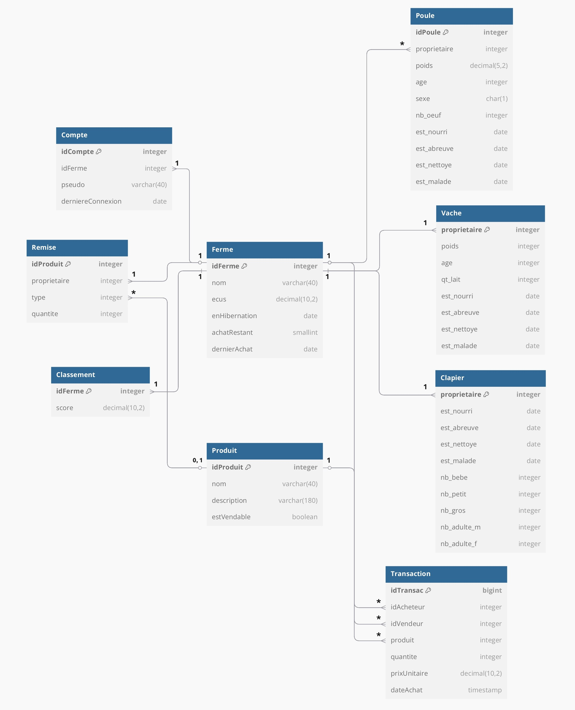

# TinyFarm - Base de donnée - 485L

## Membre de l'équipe
- BERNINI Daniele
- BLONDEAU Nathan
- DANG QUOC Viet
- DIVET Goulven
- FOUCHARD Rémi 
- IAVENAC Isaac
- LEBRUN Maxime
- MADI Takidine
- MAFOLO Joyce
- MICHON Solene
- PRUNIER Noé
- RAVARD Tony
- ROGER Gwenole
- ROUBIEU Sam
- ROULEAU Amaël
- SAADANA Adam
- SOARES--QUEBRIAC Kélig (Chef d'équipe)
- VIRENQUE Luka

## Schéma

## Description

Script de création des tables : `tables.sql`

Commande à exécuter pour les tests : `pytest tests/test_db.py`

Les tables `Ferme` & `Compte` stockent les informations globales aux différents comptes

Les tables `Poule`, `Clapier` et `Vache` gèrent les différents animaux de la ferme

Les tables `Produit`, `Commerce` et `Remise` gèrent la transaction des produits et l'économie du jeu

La table `Classement` stockent le score des différents joueurs. Elle sera accompagnée de vue matérielle (non présente pour le moment) afin de faciliter son calcul

## Répartition des taches

| Nom de la tache | Qui s'en est chargé |
|-|-|
| Création des tables | Gwénolé & Kélig, avec des suggestions de l'ensemble du groupe |
| Schéma de la base de donnée | Adam & Daniele |
| Données d'exemple | Goulven, Gwénolé & Isaac |
| Test des contraintes d'intégrité | Amaël, Joyce, Luka, Sam & Takidine |
| Test changement d'une journée à une autre | Maxime, Noé, Rémi, Solène & Tony |
| Test sur la coopérative | Goulven |
| Test transaction | Isaac & Nathan |

## Qu'est-ce qui aurait pu être amélioré
- Tout les tests dans un même fichier c'est pas super, séparé la partie fixture des différents tests individuel aurait été plus pratique à naviguer
- Gros rush sur la fin (mauvaise gestion du temps ?)